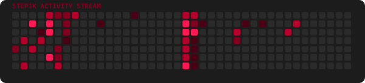

  <!-- Зацикленная матрица (Рамка и свечение: Deep Burgundy) -->
  

  

    
    
  

  
  

     
     
  

  

    
    
    
  

   

     
     
     
     
  

   

  <!-- Счетчик обращений к системе -->
  

  

    <!-- Typing SVG -->
    
  

  
  <!-- Декоративная линия профиля -->
  

  

    <!-- Трекер активности -->
    
  

  <!-- Верхний срез X2X (угол влево) -->
  

    
  

  <!-- Модуль Телеметрии: Stepik + LeetCode -->
  

    <table align="center" style="border: none; background: transparent; border-collapse: separate; border-spacing: 16px 0;">
      <tr style="border: none; background: transparent;">
        <!-- Stepik Telemetry Card -->
        <td align="center" valign="top" style="background-color: #1C1C1C; border: 2px solid #800020; border-radius: 12px; padding: 18px; box-shadow: 0 0 15px rgba(128, 0, 32, 0.4); width: 440px;">
          
            
          
          &#8287;
          
          &#8287;
          
            
          
        </td>
        <td align="center" valign="top" style="background-color: #1C1C1C; border: 2px solid #800020; border-radius: 12px; padding: 18px; box-shadow: 0 0 15px rgba(128, 0, 32, 0.4); width: 440px;">
          
            
          
        </td>
      </tr>
    </table>
  

   

  <!-- Нижний срез X2X (угол вправо) -->
  

    
  

  <!-- Прощальная GIF с бордовой рамкой и неоновым свечением #800020 -->
  

    
  

  

    
  

